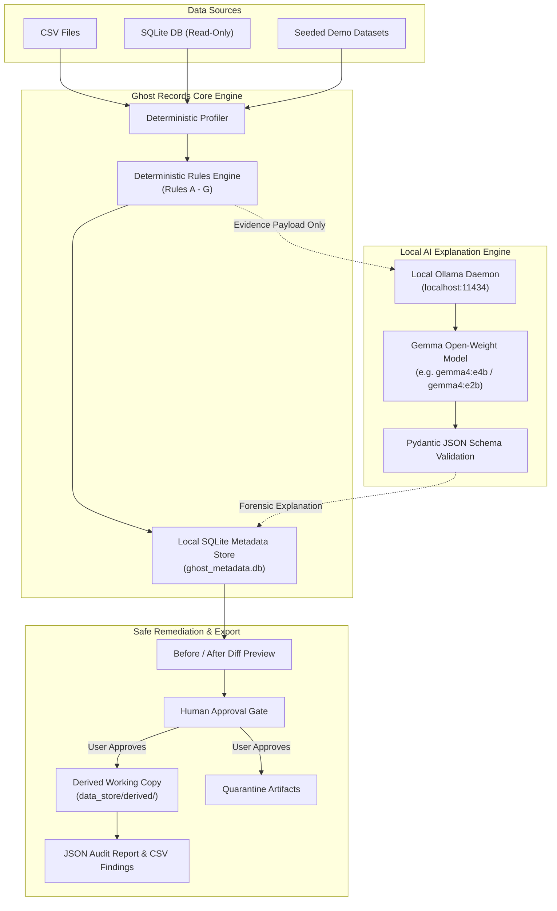

# 👻 Ghost Records

> **“Hunt down the ghosts haunting your data.”**

[](https://www.python.org/downloads/)
[](LICENSE)
[](README.md#privacy-architecture)
[](https://ollama.com)
[](tests/)

Ghost Records is a **local-first AI data quality auditor** that unmasks duplicate records, orphaned foreign keys, colliding primary keys, invalid dates, and statistical anomalies in CSV files and SQLite databases.

A locally running open-weight LLM (Gemma via Ollama) provides evidence-grounded forensic explanations and suggests safe, reviewable remediation without transmitting a single row to a third-party cloud API.

---

## 📌 Problem Statement

Real-world datasets are plagued by integrity flaws:
- **Duplicate records** inflating transaction metrics.
- **Orphaned foreign keys** referencing customer or product IDs that no longer exist.
- **Colliding primary keys** causing silent row overwrites.
- **Missing or whitespace-only values** in required operational columns.
- **Illegal negative numbers or malformed date strings**.

Traditional data quality platforms demand complex configurations, external cloud data warehouses, or expensive hosted AI APIs that violate data confidentiality. 

**Ghost Records solves this by bringing deterministic forensic audits and open-weight AI explanation directly to your local workstation.**

---

## 💡 Core Principle

```
THE RULE ENGINE DETECTS ANOMALIES.
THE LLM EXPLAINS THE EVIDENCE.
THE USER CONTROLS REMEDIATION.
```

- **Never delegate basic integrity checks to an LLM.** Basic checks must remain deterministic, verifiable, and 100% repeatable.
- **The LLM never modifies the database directly.** All transformations target explicitly approved, derived working copies. Source files remain read-only.

---

## ✨ Features

- **🔍 Dual Input Adapters**: Audit untrusted CSV files or local SQLite databases using safe, read-only connections (`mode=ro`).
- **📊 Automatic Column Profiling**: Inferred data types, null counts, unique percentages, duplicate row counts, and candidate primary key discovery.
- **🛡️ 7 Deterministic Audit Rules**:
  - **Rule A (Exact Duplicates)**: Detects multi-column duplicate clusters.
  - **Rule B (Duplicate Identifiers)**: Identifies primary key collisions with differing payload attributes. Null identifiers are strictly isolated from duplicate ID logic.
  - **Rule C (Orphaned Foreign Keys)**: Detects broken relational links across tables while respecting nullable relationships.
  - **Rule D (Missing Values)**: Audits nulls, empty strings, and whitespace-only entries in required fields.
  - **Rule E (Invalid Dates & Values)**: Flags out-of-range dates, parsing failures, and illegal negative values.
  - **Rule F (Suspicious Outliers)**: Identifies statistical anomalies using the transparent Interquartile Range (IQR $\times$ 1.5) method.
  - **Rule G (Inconsistent Relationships)**: Verifies relational schemas and key integrity.
- **🤖 Evidence-Grounded Local AI (Gemma via Ollama)**:
  - Generates structured JSON explanations (Summary, Why Flagged, Plausible Hypotheses, Human Verification Steps, Recommended Remediation, Confidence Statement).
  - Strict negative constraints: Never invents IDs, never claims external lookups, distinguishes observed facts from hypotheses.
  - Graceful degradation: Deterministic scanning is 100% functional even when Ollama is offline.
- **🛠️ Safe Human-in-the-Loop Remediation**:
  - Before/after diff previews of proposed fixes.
  - Non-destructive execution: Saves clean datasets and isolated quarantine files in `data_store/derived/`. Source files are never modified.
  - One-click derived verification scan to confirm zero residual anomalies.
- **📦 Multi-Format Reporting**:
  - Export comprehensive audit packages in JSON and flat CSV formats.
  - Immutable audit trail recording every scan, query, and decision.
- **🚀 Seeded Synthetic Demo Generator**: Instant 1-click loading of customers, products, and orders datasets with ground-truth seeded anomalies.

---

## 🏗️ Architecture



---

## 💻 Technology Stack

| Component | Technology | Rationale |
|---|---|---|
| **Language** | Python 3.11+ | High-performance data manipulation and cross-platform compatibility |
| **Web Interface** | Streamlit | Rapid, developer-focused forensic workspace |
| **Data Engine** | Pandas & NumPy | High-speed vectorized data operations |
| **Persistence** | SQLite 3 | Embedded metadata storage with zero external database dependencies |
| **Local LLM Inference** | Ollama | 100% offline open-weight model serving |
| **Forensic Model** | `gemma4:e4b` / `gemma4:e2b` | Open-weight foundation model with rigorous instruction adherence |
| **Data Validation** | Pydantic v2 | Enforces strict schema conformity on AI JSON outputs |
| **Testing** | pytest | Automated test coverage for all rules and failure modes |
| **Linting & Formatting** | Ruff | Modern, lightning-fast Python linter |

---

## ⚙️ Installation & Setup

### Prerequisites
- Python 3.11 or newer
- [Ollama](https://ollama.com) installed locally (for AI explanations)

### 1. Clone & Set Up Virtual Environment
```bash
git clone https://github.com/yashr5120/Ghost-Records.git
cd Ghost-Records

# Create and activate virtual environment
python -m venv venv

# Windows:
venv\Scripts\activate

# macOS / Linux:
source venv/bin/activate
```

### 2. Install Dependencies
```bash
pip install -r requirements.txt
```

### 3. Verify Local Ollama & Model
Ghost Records uses existing open-weight models without unnecessary downloads:
```bash
# Check if Ollama is running and inspect models:
ollama list
```

If you have `gemma4:e4b` or `gemma4:e2b` installed, Ghost Records will automatically detect and utilize it. You can configure any model name in `.env` or in the **Settings** page:
```bash
cp .env.example .env
```

*Note: If Ollama is offline or no model is installed, Ghost Records remains 100% operational in deterministic mode.*

---

## 🚀 Running the Application

Launch the Streamlit web interface:
```bash
streamlit run app.py
```
Open your browser at `http://localhost:8501`.

---

## 🧪 Ground-Truth Evaluation & Seeded Demo

Ghost Records includes synthetic demo datasets with **explicitly documented ground-truth anomalies**:

| Dataset | Seeded Anomalies | Deterministic Rules Triggered | Detection Count | False Positives |
|---|---|---|:---:|:---:|
| **Customers** (24 rows) | CUST-103 exact duplicate, CUST-105 duplicate ID collision, missing emails on CUST-110/111, invalid dates on CUST-115/116, $950K extreme spend outlier | Rule A, Rule B, Rule D, Rule E, Rule F | **5 findings** | **0** |
| **Products** (12 rows) | Blank SKU on PROD-08, negative stock on PROD-09 (-15), negative unit price on PROD-10 (-$49.99) | Rule D, Rule E | **3 findings** | **0** |
| **Orders** (23 rows) | Orphan customer IDs (CUST-9999, CUST-8888), orphan product IDs (PROD-999, PROD-888), exact duplicate ORD-508, duplicate ID ORD-510, invalid date ORD-515, negative quantity ORD-518, outliers | Rule A, Rule B, Rule C (Customer), Rule C (Product), Rule E, Rule F | **9 findings** | **0** |

### Evaluation Verification:
- **Total Seeded Anomalies**: 17
- **Correctly Detected by Scanner**: 17 / 17 (100% recall)
- **False Positives in Fixture**: 0 (100% precision)
- **Local AI Explanations**: Verified online using `gemma4:e4b` via Ollama.
- **Offline Resilience**: Verified with Ollama offline; deterministic engine detected all 17 findings without degradation.

---

## 🔬 Example Anomaly Investigation

### Observed Evidence (Rule C: Orphan Foreign Key)
- **Child Table**: `orders`
- **Foreign Key**: `customer_id`
- **Affected Rows**: 2 (`ORD-501`, `ORD-502`)
- **Missing Parent Values**: `CUST-9999`, `CUST-8888`
- **Parent Table Checked**: `customers.customer_id`

### Generated Local AI Forensic Output
```json
{
  "summary": "Detected 2 order records referencing customer identifiers that do not exist in the customers table.",
  "why_flagged": "Foreign key constraint failure: customer_id values CUST-9999 and CUST-8888 are missing from parent table customers.",
  "likely_explanations": [
    "Customer records were archived or deleted while associated order history was retained.",
    "Order entry entered a typographical error for customer identifier.",
    "Orders were imported from an upstream e-commerce platform before customer account synchronization completed."
  ],
  "verification_steps": [
    "Query authoritative master customer database for CUST-9999 and CUST-8888.",
    "Inspect payment processor receipts corresponding to orders ORD-501 and ORD-502."
  ],
  "recommended_remediation": "Quarantine orders ORD-501 and ORD-502 into an audit review file. Never invent synthetic replacement customer IDs.",
  "confidence_statement": "High certainty based on exact set mismatch against the supplied customers dataset."
}
```

---

## 🔒 Privacy Architecture

Ghost Records is engineered for strict enterprise compliance and confidential data:
1. **100% Local Inference**: All prompts are sent exclusively to `http://localhost:11434`. Zero cloud AI APIs.
2. **Minimal Evidence Payloads**: Whole datasets are **never** passed to the LLM. Only anonymized evidence snippets (rule ID, column name, key value) are sent.
3. **Source Immutability**: Uploaded SQLite databases are accessed strictly in read-only mode (`mode=ro`). Transformations are written exclusively to `data_store/derived/`.
4. **Zero Telemetry**: No tracking, phone-home metrics, or external network calls.

---

## 🧪 Automated Test Suite

Ghost Records maintains a complete test suite covering rules, profiling, safe remediation, reports, and AI failure modes.

Run all tests:
```bash
python -m pytest -v
```

Run linting:
```bash
python -m ruff check ghost_records tests pages app.py
```

### Test Coverage Highlights:
- `test_duplicates.py`: Exact duplicate rows, duplicate identifiers, null identifier isolation.
- `test_foreign_keys.py`: Valid keys, missing parents, nullable keys, empty parent tables.
- `test_profiling.py`: Empty dataframes, missing/whitespace analysis, candidate key discovery.
- `test_remediation.py`: Immutability of source data, quarantine artifact generation, derived copies.
- `test_reporting.py`: JSON audit export, CSV findings spreadsheet.
- `test_ai_client.py`: Offline graceful degradation, structured response schema validation, timeout handling.

---

## 🌐 Why Open Innovation Matters

In the era of cloud-hosted AI, organizations frequently face an impossible compromise: **surrender dataset privacy to hosted model providers or forgo intelligent audit assistance entirely.**

**Ghost Records demonstrates that open-weight AI flips this equation:**
- **Sovereign Data Audits**: Healthcare, financial, and proprietary enterprise data can be audited safely on air-gapped or local workstations.
- **Model Interoperability**: Because inference uses open Ollama standards, users can swap `gemma4:e4b` for any open-weight model (`gemma`, `llama`, `mistral`, `qwen`) without altering a line of business logic.
- **Community Extensibility**: Anyone can contribute specialized rules (e.g., industry-specific HIPAA or GDPR checks) or new database adapters (Postgres, DuckDB) under the permissive MIT license.

### Licensing Distinction
- **Application Code**: Licensed under the [MIT License](LICENSE).
- **AI Model**: The Gemma model family is distributed by Google under the [Gemma Terms of Use](https://ai.google.dev/gemma/terms). Ghost Records interacts with the model purely as a client over Ollama's local HTTP API and does not redistribute model weights.

---

## 🗺️ Known Limitations & Future Roadmap

### Current Limitations (MVP)
- Single-table auditing with explicit cross-table mapping (multi-table automatic join graph analysis planned for v0.2).
- Large dataset performance is optimized for datasets up to 100,000 rows (future versions will leverage DuckDB for multi-gigabyte files).
- Ollama inference speed depends on local CPU/GPU hardware.

### Roadmap
- [ ] Direct read-only connectors for PostgreSQL and DuckDB.
- [ ] Cross-table fuzzy matching for entity resolution (e.g. slight name typos).
- [ ] Exportable Pandera validation schema generation based on audit results.
- [ ] Scheduled recurring audit background tasks.

---

## 🤝 Contributing

Contributions are welcomed! Check out [CONTRIBUTING.md](CONTRIBUTING.md) for code conventions, testing guidelines, and submission steps.

---

## 📄 License

This project is open-source under the [MIT License](LICENSE).
